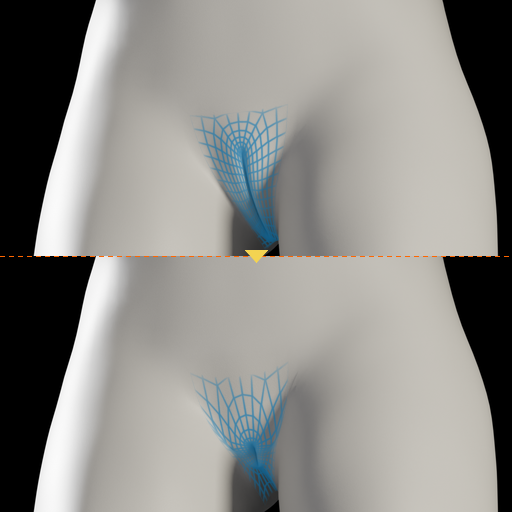
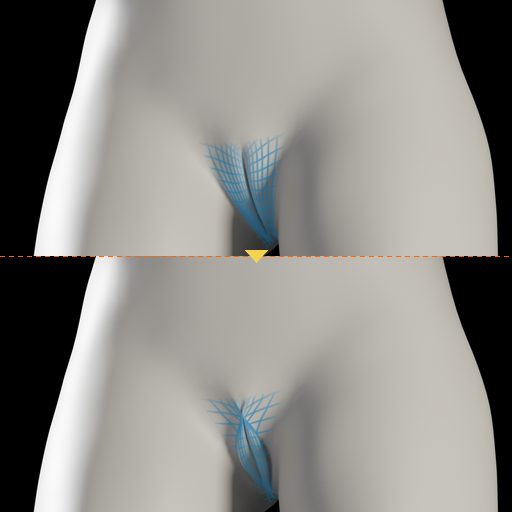
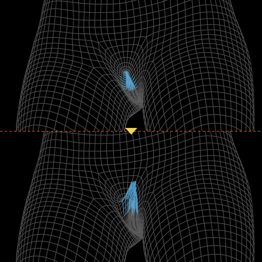
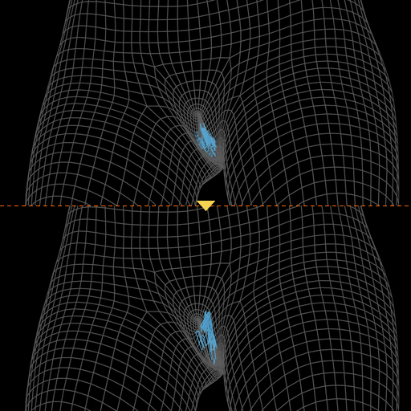
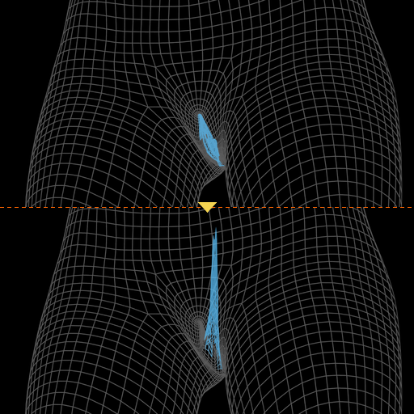
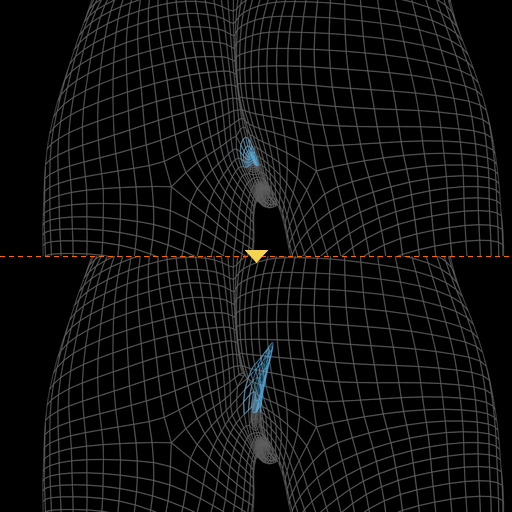
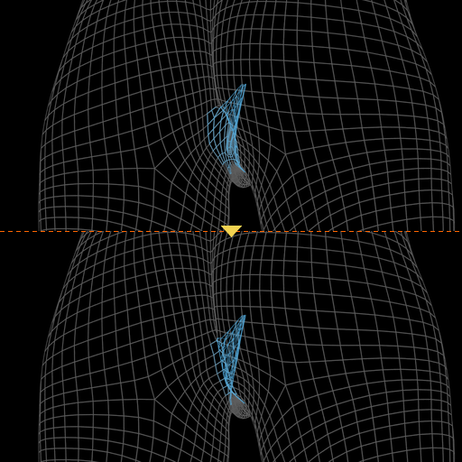
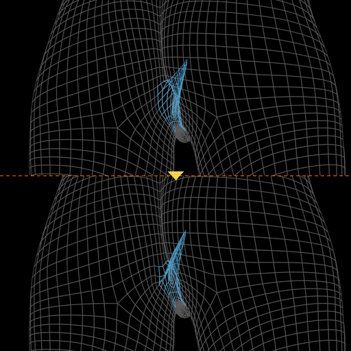

# Intimate anatomy

8 thumbnails for the anatomy targets of frankyaye.
These targets work only on a proxy with genitals, the base mesh has no geometry there.

- Vulva_Short and Vulva_Narrow: on the CC0 proxy wolgade_female_generic_with_simplified_genitals.
- Vulva Deep and Anus_deep: on the AGPL proxy Adult Female Genitalia, shown as a wireframe under a black skin, with the inner part in transparency.
- Anus_small_width and Anus_small_length: same proxy, but they need Anus_deep first, so they are shown on top of it.

<table>
<tr>
<td align="center"> Vulva_Short</td>
<td align="center"> Vulva_Narrow</td>
<td align="center"> Vulva_Deep_Top</td>
<td align="center"> Vulva_Deep_Middle</td>
</tr>
<tr>
<td align="center"> Vulva_Deep_Low</td>
<td align="center"> Anus_deep</td>
<td align="center"> Anus_small_width</td>
<td align="center"> Anus_small_length</td>
</tr>
</table>
