# Asymmetry

31 thumbnails for the asym sliders.
The face is shown at one end of the slider, the mesh of the zone moved is drawn in blue.

<table>
<tr>
<td align="center">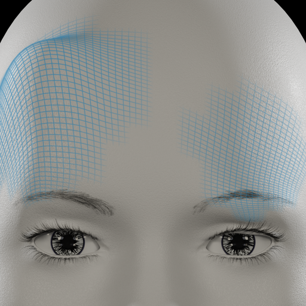 asym-brown-1-l-r</td>
<td align="center">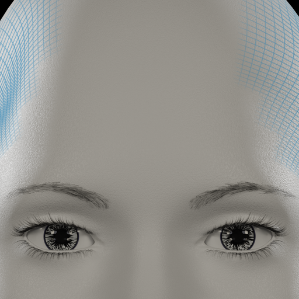 asym-brown-2-l-r</td>
<td align="center">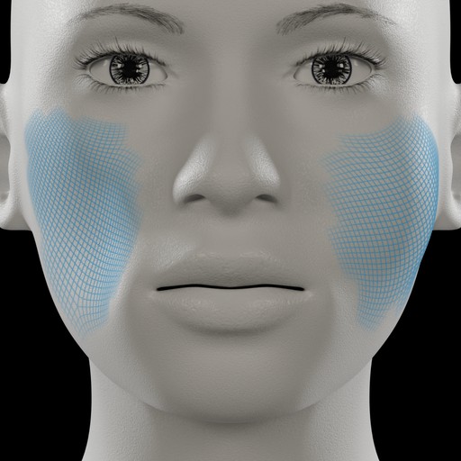 asym-cheek-1-l-r</td>
<td align="center">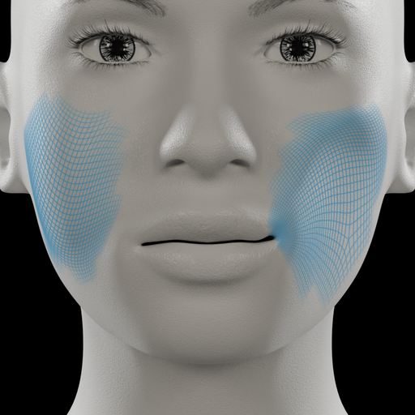 asym-cheek-2-l-r</td>
</tr>
<tr>
<td align="center">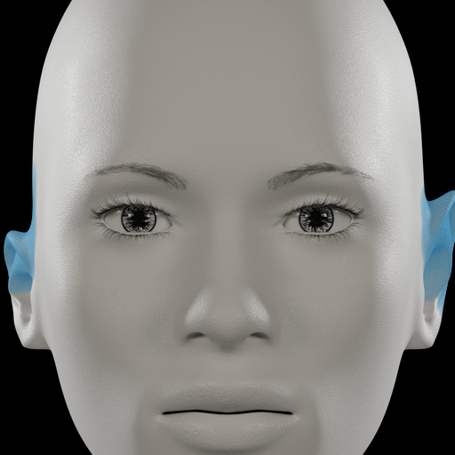 asym-ear-1-l-r</td>
<td align="center">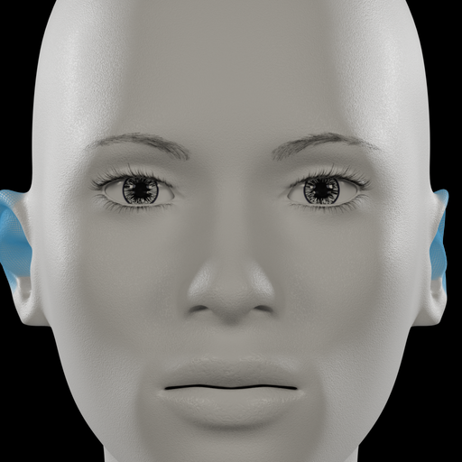 asym-ear-2-l-r</td>
<td align="center">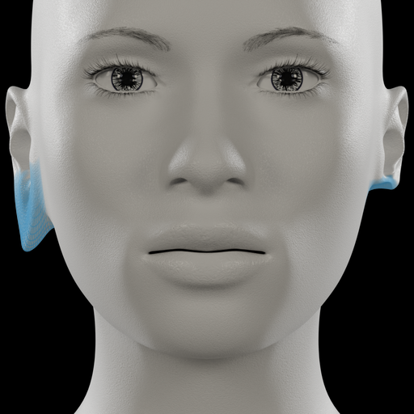 asym-ear-3-l-r</td>
<td align="center">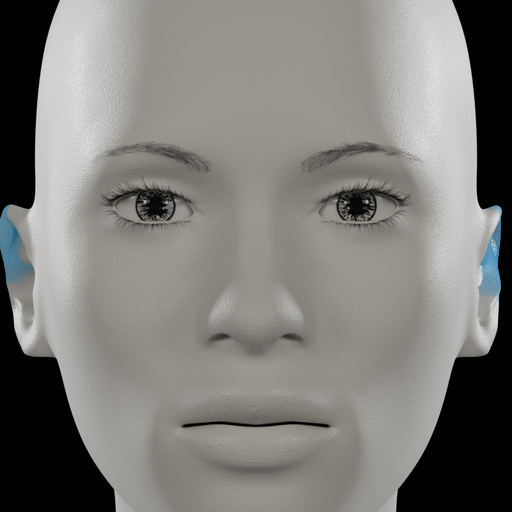 asym-ear-4-l-r</td>
</tr>
<tr>
<td align="center">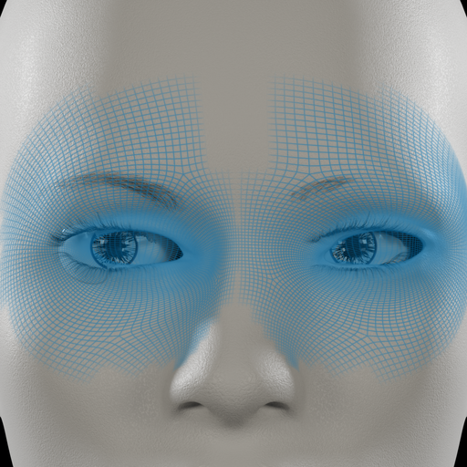 asym-eye-1-l-r</td>
<td align="center">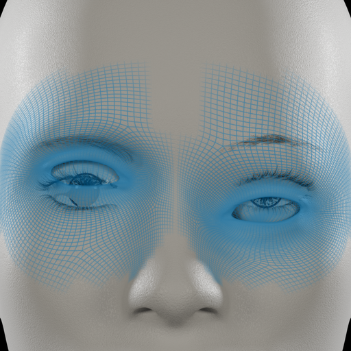 asym-eye-2-l-r</td>
<td align="center">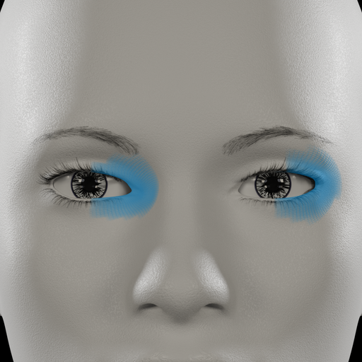 asym-eye-3-l-r</td>
<td align="center">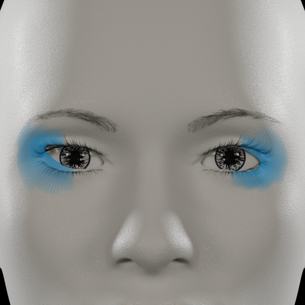 asym-eye-4-l-r</td>
</tr>
<tr>
<td align="center">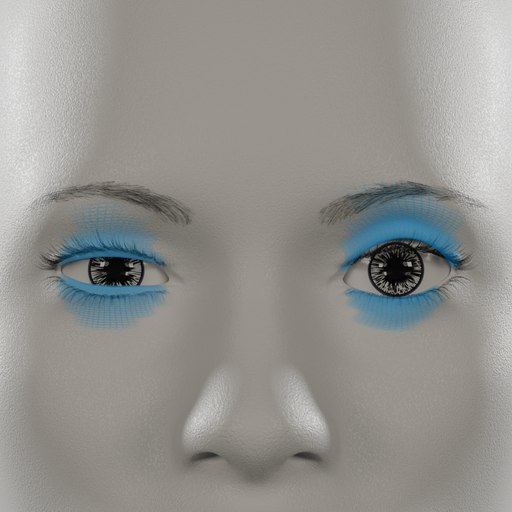 asym-eye-5-l-r</td>
<td align="center">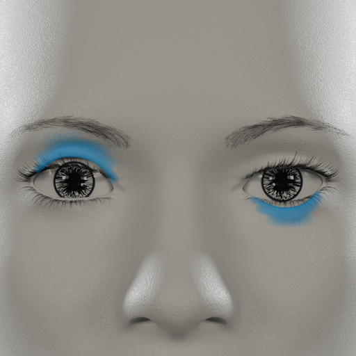 asym-eye-6-l-r</td>
<td align="center">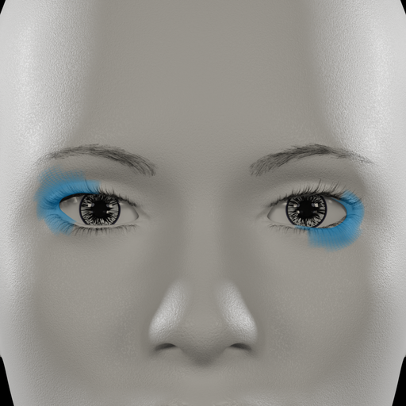 asym-eye-7-l-r</td>
<td align="center">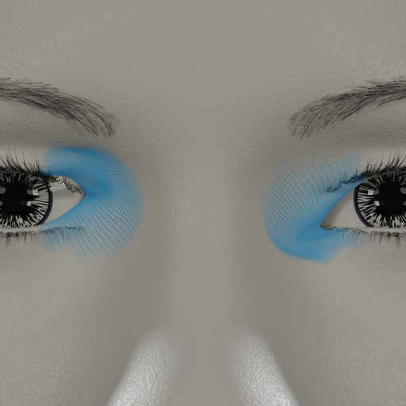 asym-eye-8-l-r</td>
</tr>
<tr>
<td align="center">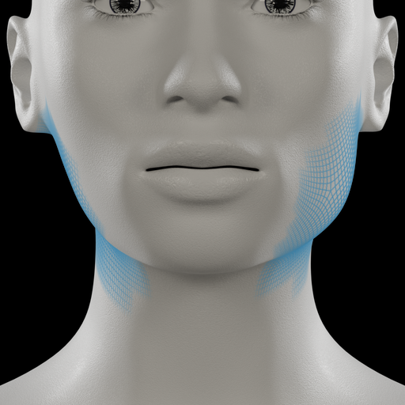 asym-jaw-1-l-r</td>
<td align="center">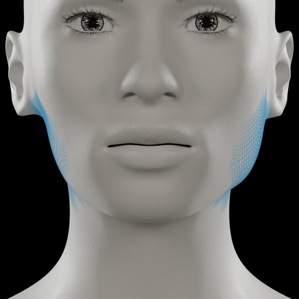 asym-jaw-2-l-r</td>
<td align="center">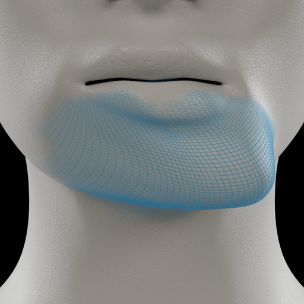 asym-jaw-3-l-r</td>
<td align="center">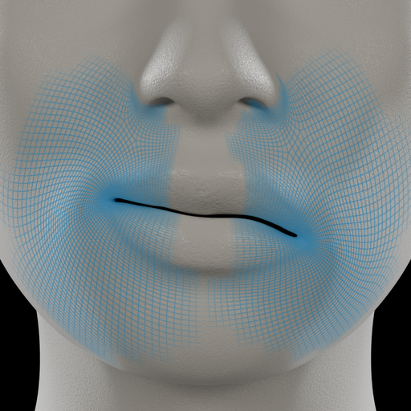 asym-mouth-1-l-r</td>
</tr>
<tr>
<td align="center">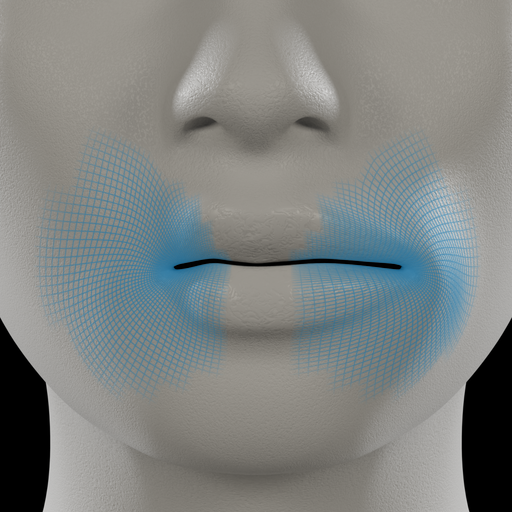 asym-mouth-2-l-r</td>
<td align="center">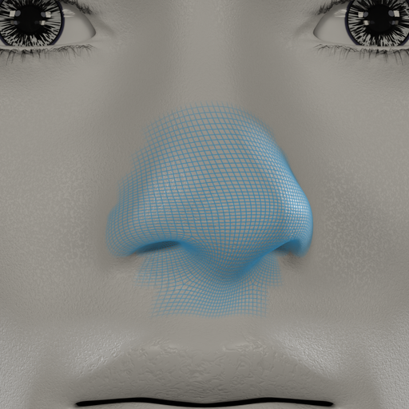 asym-nose-1-l-r</td>
<td align="center">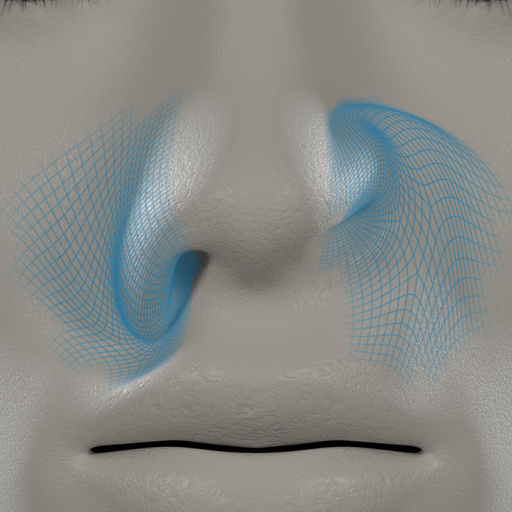 asym-nose-2-l-r</td>
<td align="center">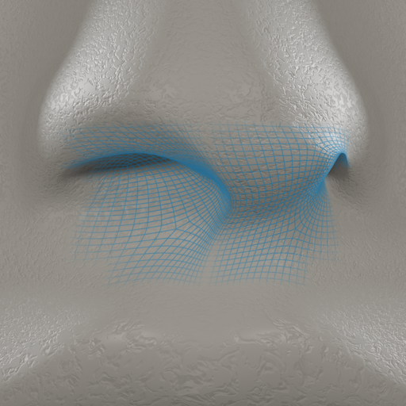 asym-nose-3-l-r</td>
</tr>
<tr>
<td align="center">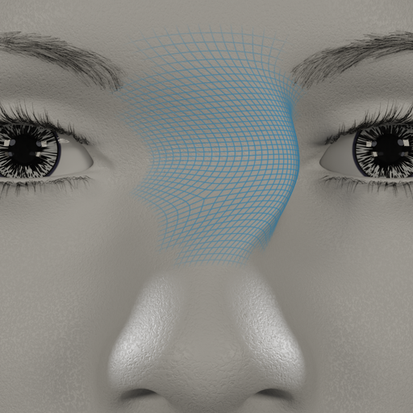 asym-nose-4-l-r</td>
<td align="center">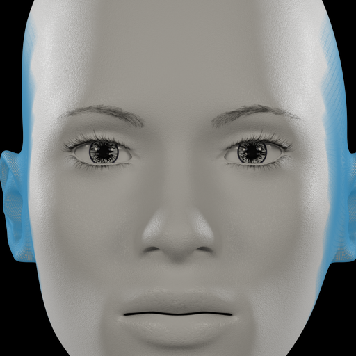 asym-temple-1-l-r</td>
<td align="center">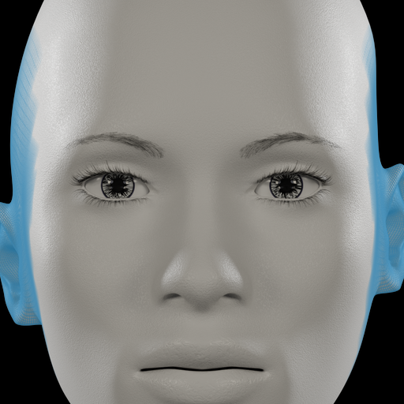 asym-temple-2-l-r</td>
<td align="center">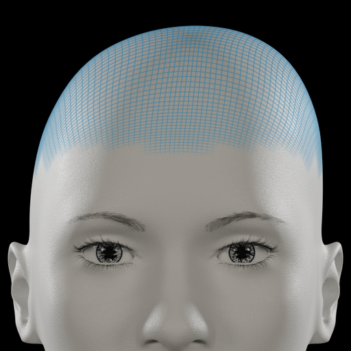 asym-top-1-l-r</td>
</tr>
<tr>
<td align="center">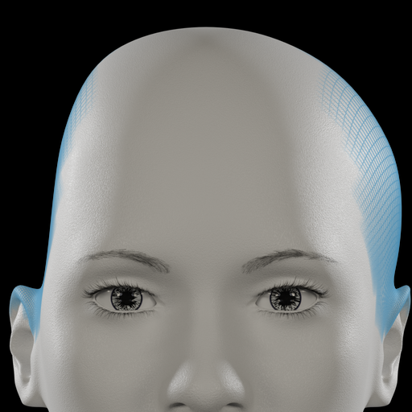 asym-top-2-l-r</td>
<td align="center">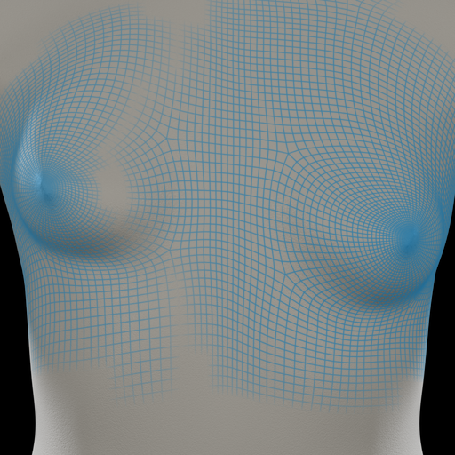 asymm-breast-1-l-r</td>
<td align="center">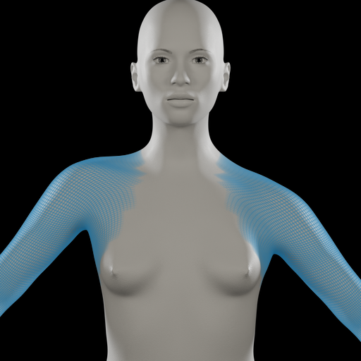 asymm-trunk-1-l-r</td>
</tr>
</table>
