# Hands and feet

Thumbnails for the 28 official MPFB hand and foot targets, left side only.
Neutral and modified, with an arrow. For the fingers diameter and distance, both ends of the slider, and an animated version.

It uses the wireframe patch, which displays the part of mesh deformed as a blue
wireframe.

<table>
<tr>
<td align="center">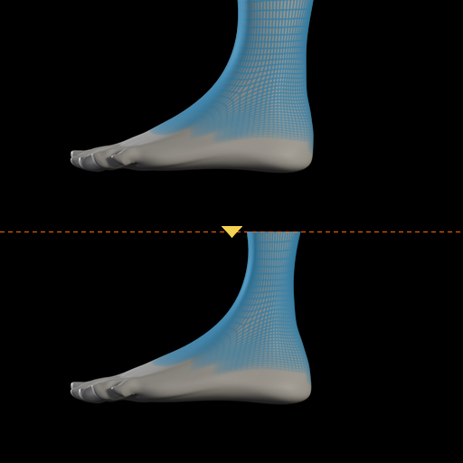 l-ankle-circ-decr</td>
<td align="center">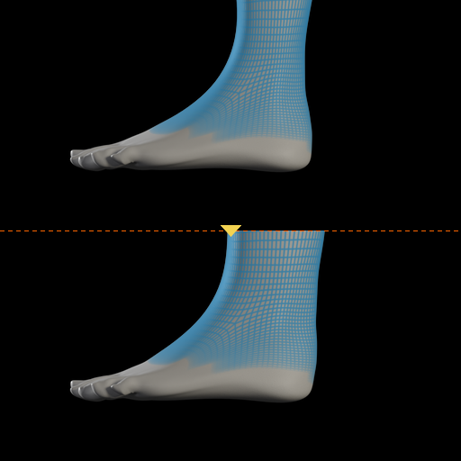 l-ankle-circ-incr</td>
<td align="center">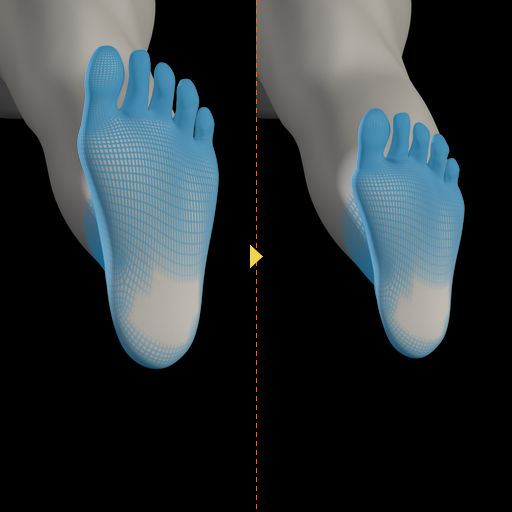 l-foot-scale-decr</td>
<td align="center">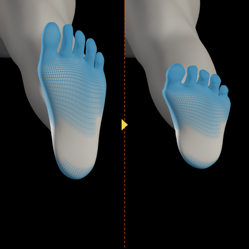 l-foot-scale-depth-decr</td>
</tr>
<tr>
<td align="center">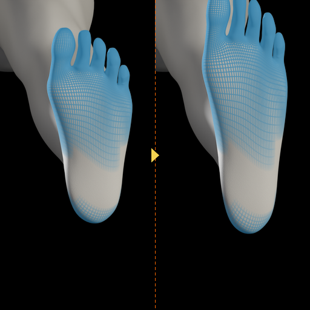 l-foot-scale-depth-incr</td>
<td align="center">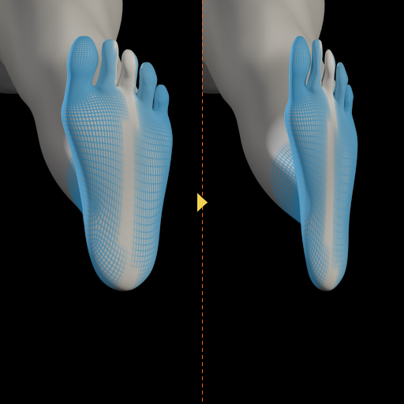 l-foot-scale-horiz-decr</td>
<td align="center">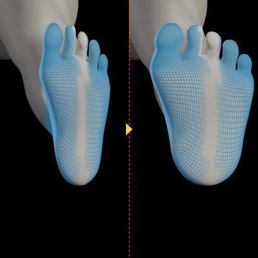 l-foot-scale-horiz-incr</td>
<td align="center">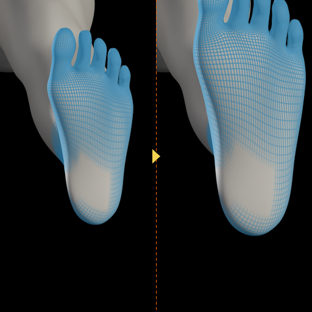 l-foot-scale-incr</td>
</tr>
<tr>
<td align="center">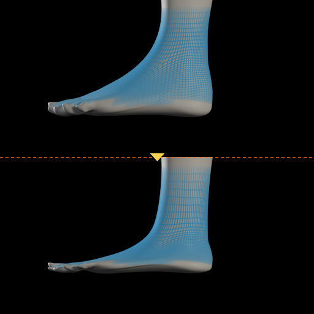 l-foot-scale-vert-decr</td>
<td align="center">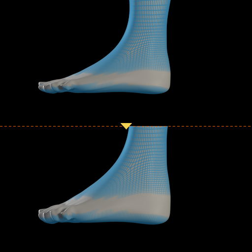 l-foot-scale-vert-incr</td>
<td align="center">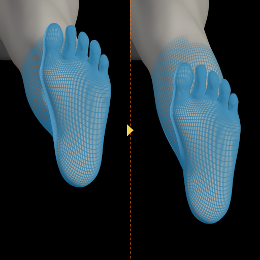 l-foot-trans-backward</td>
<td align="center">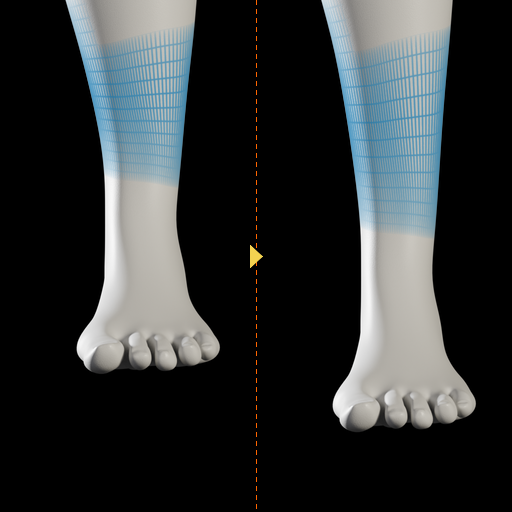 l-foot-trans-down</td>
</tr>
<tr>
<td align="center">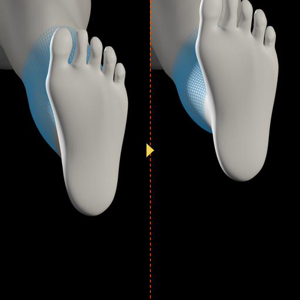 l-foot-trans-forward</td>
<td align="center">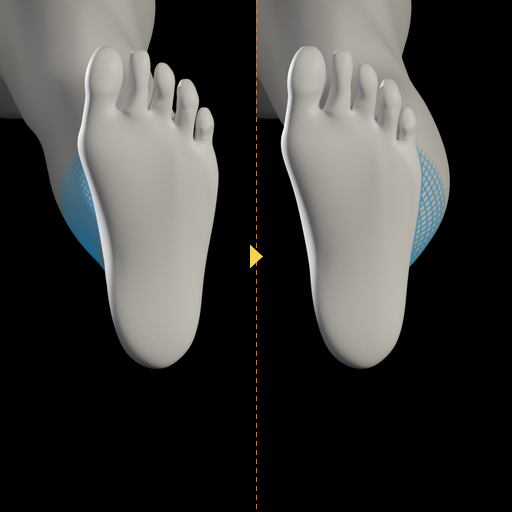 l-foot-trans-in</td>
<td align="center">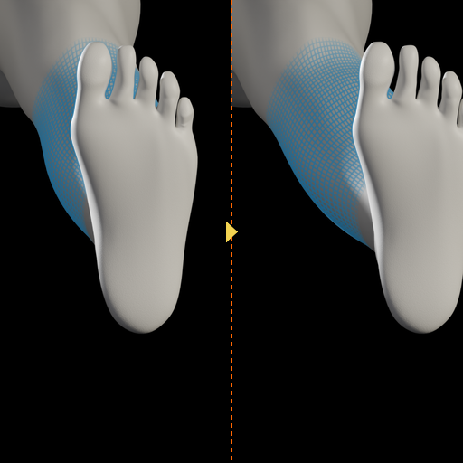 l-foot-trans-out</td>
<td align="center">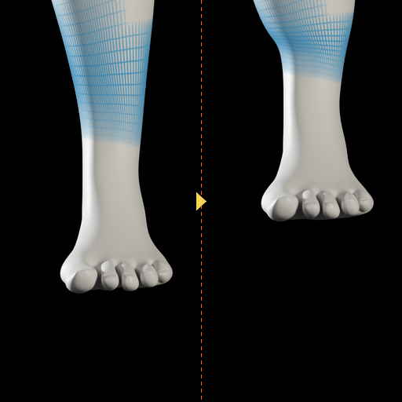 l-foot-trans-up</td>
</tr>
<tr>
<td align="center">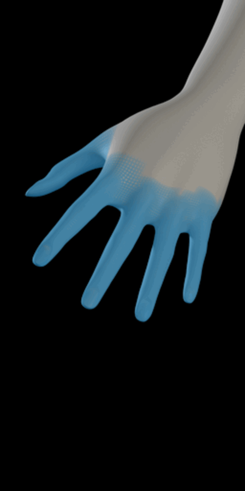 l-hand-fingers-diameter-decr-incr (ani…</td>
<td align="center">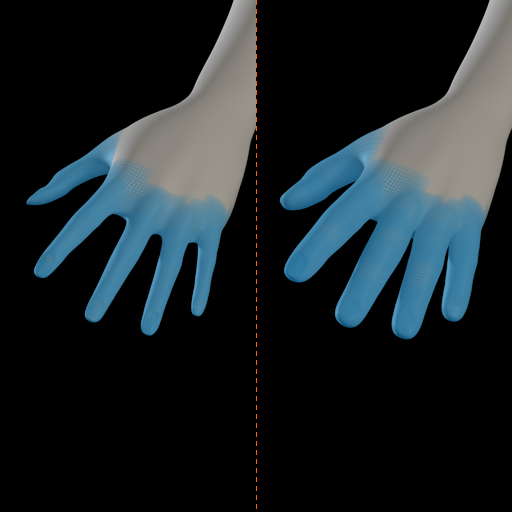 l-hand-fingers-diameter-decr-incr</td>
<td align="center">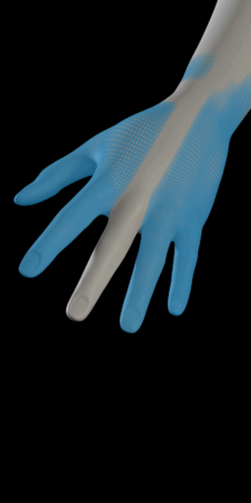 l-hand-fingers-distance-decr-incr (ani…</td>
<td align="center">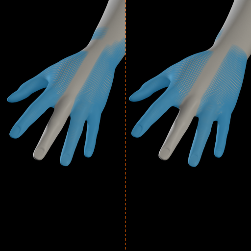 l-hand-fingers-distance-decr-incr</td>
</tr>
<tr>
<td align="center">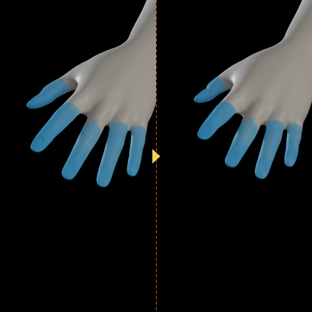 l-hand-fingers-length-decr</td>
<td align="center">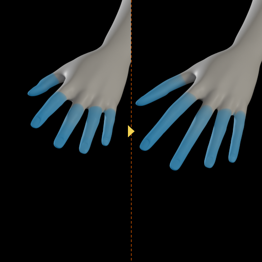 l-hand-fingers-length-incr</td>
<td align="center">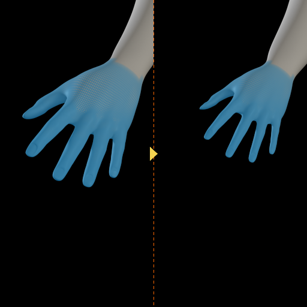 l-hand-scale-decr</td>
<td align="center">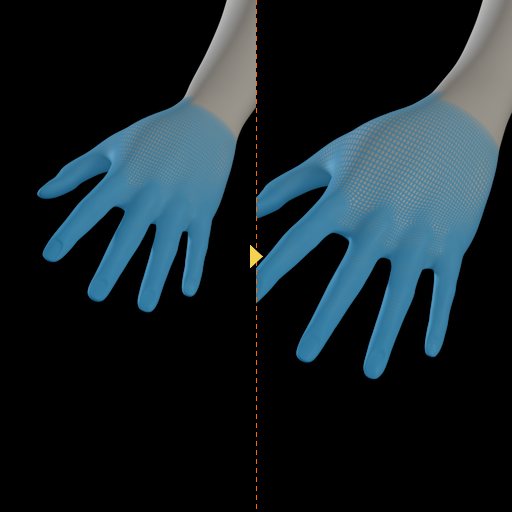 l-hand-scale-incr</td>
</tr>
<tr>
<td align="center">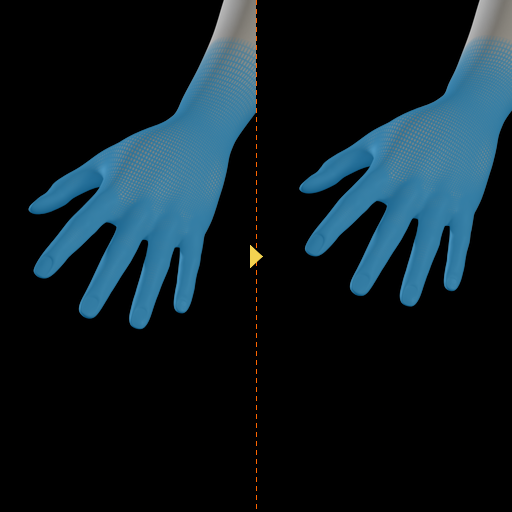 l-hand-trans-in</td>
<td align="center">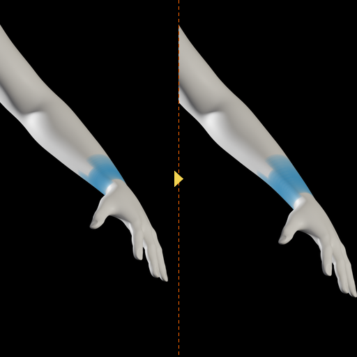 l-hand-trans-out</td>
<td align="center">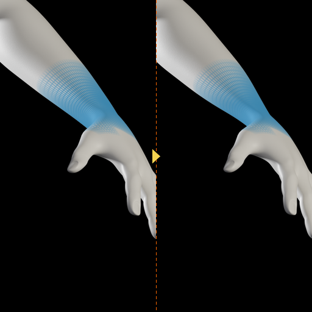 l-wrist-circ-decr</td>
<td align="center">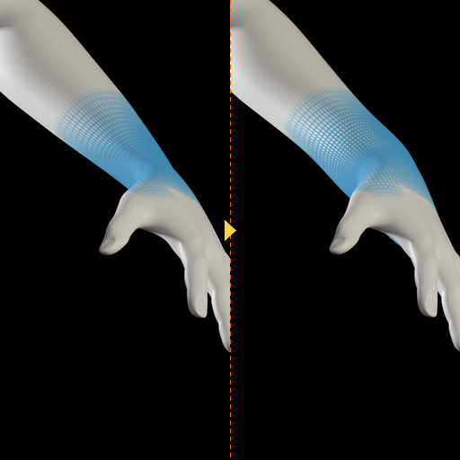 l-wrist-circ-incr</td>
</tr>
</table>
