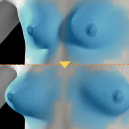
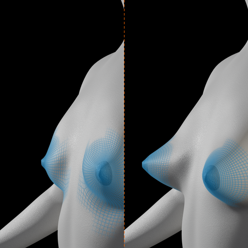
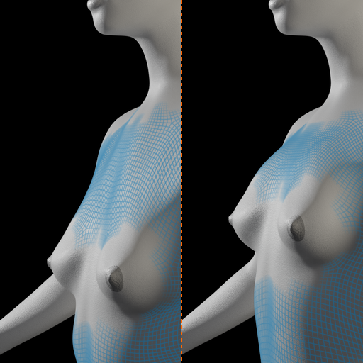
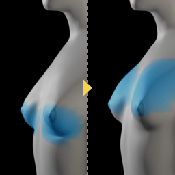
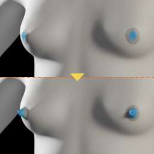
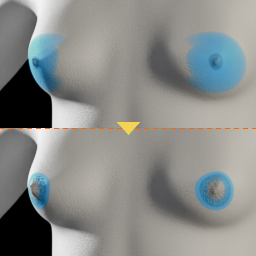

# Breast

6 thumbnails for the breast sliders, the same Joel validated in September.
The zone moved is painted in blue on both halves.

<table>
<tr>
<td align="center"> breast-dist-decr-incr</td>
<td align="center"> breast-point-decr-incr</td>
<td align="center"> breast-trans-down-up</td>
<td align="center"> breast-volume-vert-down-up</td>
</tr>
<tr>
<td align="center"> nipple-point-decr-incr</td>
<td align="center"> nipple-size-decr-incr</td>
</tr>
</table>
