# Proxies

29 thumbnails for the proxies of the two packs, the same as in thumbnail_overrides.
The mesh is drawn as a wireframe, in blue where it is different from the base mesh.

<table>
<tr>
<td align="center">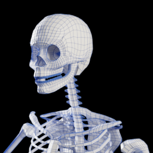 calamidades_culeverita</td>
<td align="center">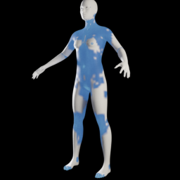 callharvey3d_harvey_proxy1</td>
<td align="center">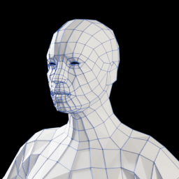 cortu_uni1228_unisex_game_model</td>
<td align="center">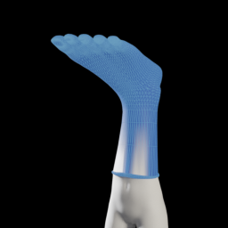 culturalibre_big_foot</td>
</tr>
<tr>
<td align="center">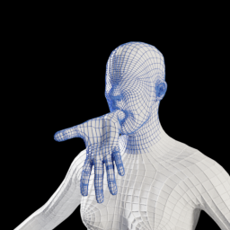 culturalibre_blind_hand</td>
<td align="center">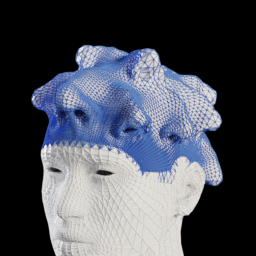 culturalibre_noses</td>
<td align="center">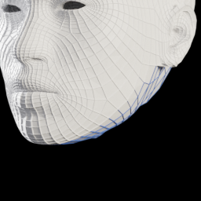 duarteemerich_fully_bodyless_head</td>
<td align="center">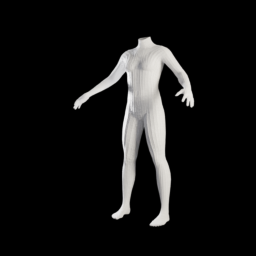 duarteemerich_headless</td>
</tr>
<tr>
<td align="center">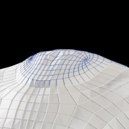 duarteemerich_headless_2</td>
<td align="center">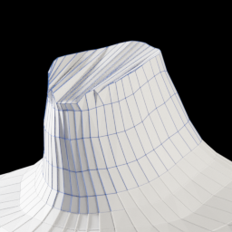 duarteemerich_headless_3</td>
<td align="center">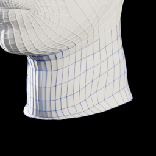 duarteemerich_neck_deatached_from_body</td>
<td align="center">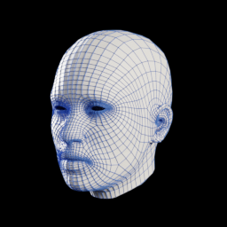 duarteemerich_severed_head</td>
</tr>
<tr>
<td align="center">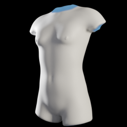 duarteemerich_torso</td>
<td align="center">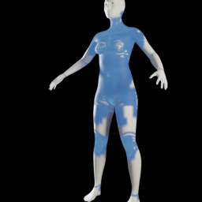 elvaerwyn_punkelvs_female_proxy1</td>
<td align="center">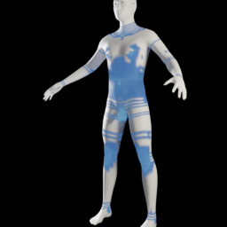 elvaerwyn_punkelvs_male_proxy1</td>
<td align="center">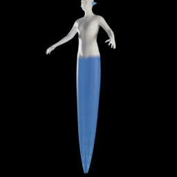 joachip_snek</td>
</tr>
<tr>
<td align="center">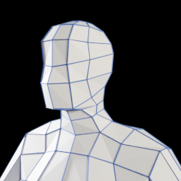 joel_palmius_very_low_poly</td>
<td align="center">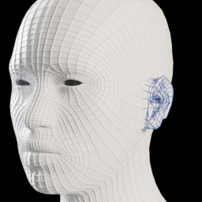 jujube_alpha_7_ear_topology</td>
<td align="center">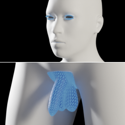 jujube_proxy_with_helpers_test</td>
<td align="center">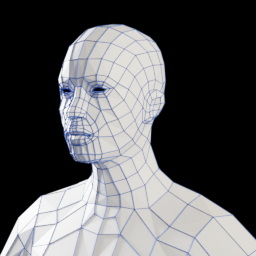 myxibrium_low_poly_with_mouth_interior</td>
</tr>
<tr>
<td align="center">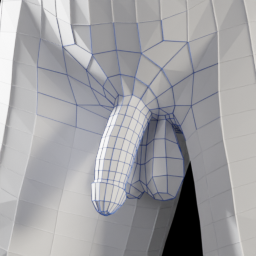 porky11_simple_penis</td>
<td align="center">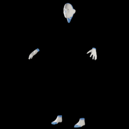 punkduck_ava_ex_machina_proxy</td>
<td align="center">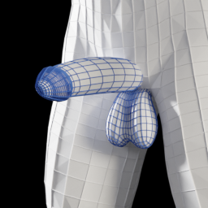 slayer227_erect_penis_only_works_with_…</td>
<td align="center">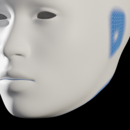 smonbrogg_head_only</td>
</tr>
<tr>
<td align="center">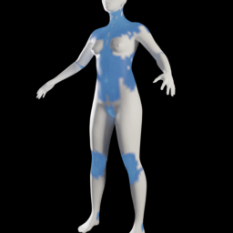 spamrakuen_female_generic_with_simplif…</td>
<td align="center">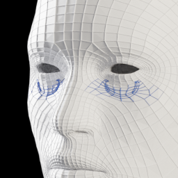 spamrakuen_sr_anime_topo_01</td>
<td align="center"> wolgade_female_generic_with_simplified…</td>
<td align="center">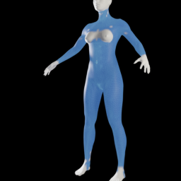 wolgade_female_less_muscular_with_simp…</td>
</tr>
<tr>
<td align="center">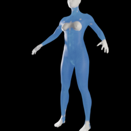 wolgade_female_muscular_with_simplifie…</td>
</tr>
</table>
